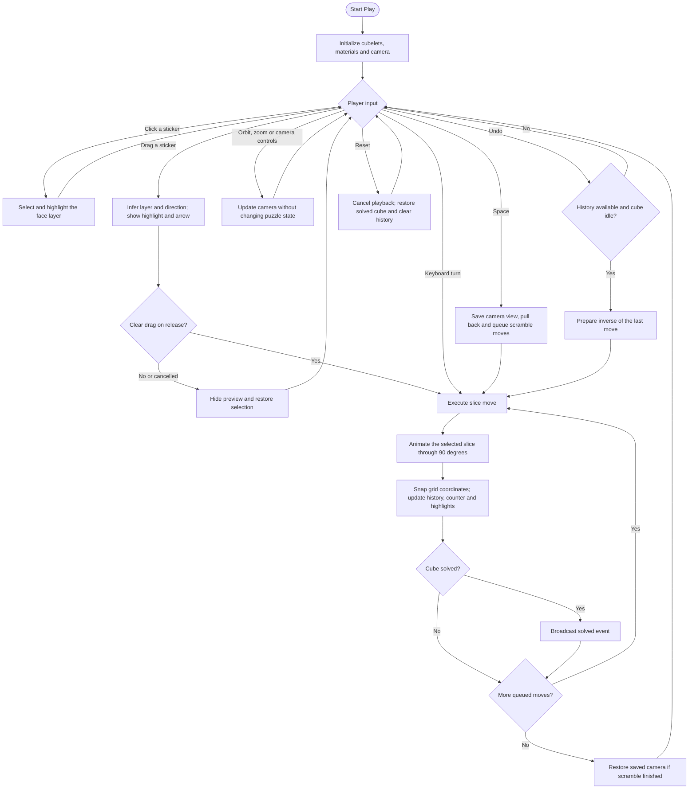

# RubiksCube

An interactive 3×3×3 Rubik's Cube built with **Unreal Engine 5.8** and **C++**.

## Features

- Direct mouse-driven layer turns with smooth 90° animations.
- Click-to-select layer highlighting and a curved cyan move-preview arrow.
- Camera orbit, zoom, and selected-face viewing.
- Animated scrambling with a temporary wider camera view.
- Move history, undo, and puzzle reset.
- Integer grid coordinates that keep puzzle mechanics separate from visual presentation.

## Rubik's Cube flow

## Controls

| Input | Action |
| --- | --- |
| Left-click a sticker | Select and highlight that face's outer layer |
| Left-drag a sticker, then release | Preview and turn a layer 90° |
| Right-click and drag | Orbit around the cube |
| Mouse wheel | Zoom in or out |
| Ctrl+Z or Z | Undo the last move |
| Space | Scramble |
| R | Reset the puzzle |
| F | Restore the selected-face camera view |
| V | Toggle Play / Inspect |
| Tab | Cycle the selected axis |
| Up / Down arrows | Change the selected layer |
| Left / Right arrows | Turn the selected layer |
| Escape | Cancel a preview; in Unreal's editor it may also stop Play |

A short drag or dragging back to the starting point cancels the turn. The layer highlight and arrow show the pending move before release. Scrambling temporarily moves the camera to a wider perspective, then restores its previous view.

## Project structure

- `Source/RubiksCube/Actors`: cube gameplay, interaction, camera, and presentation.
- `Source/RubiksCube/Components`: cubelet geometry, stickers, and highlights.
- `Source/RubiksCube/Data`: move definitions and enums.
- `Content/CubeStudio`: Blueprint, input actions, materials, and UI assets.
- `Content/Maps`: demonstration map and supporting assets.
- `Config`: project and input configuration.

Generated build output, caches, local settings, and IDE solution files are ignored by Git. Unreal regenerates them locally. The checked-in assets are stored directly in Git; Git LFS is not required for this snapshot.
